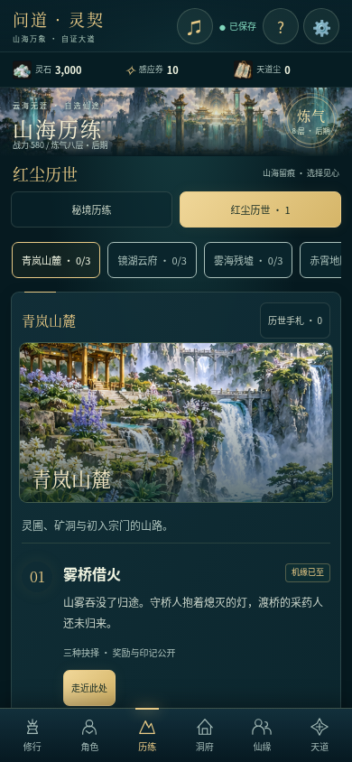
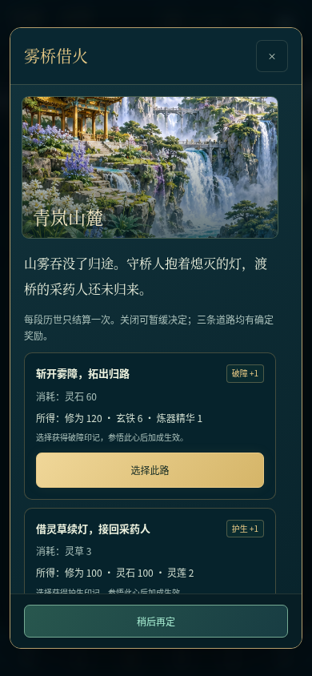
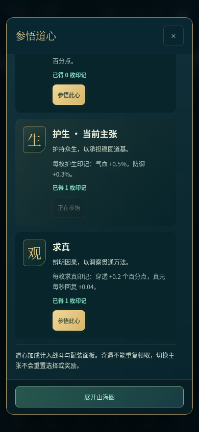
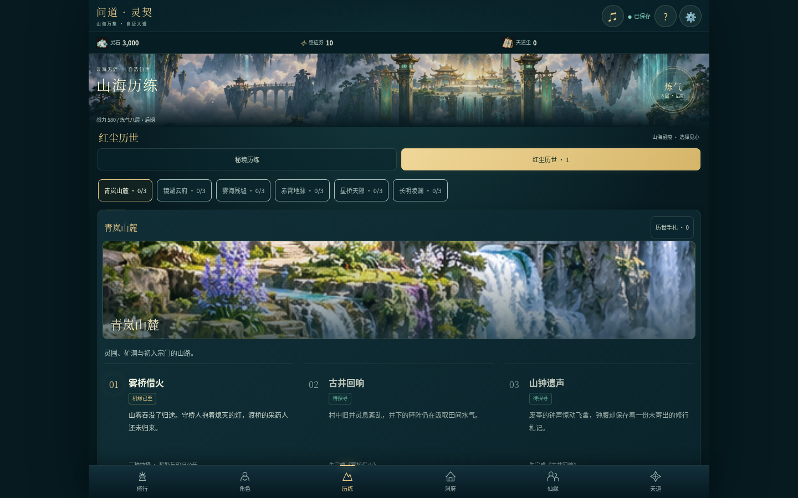

# V4.2 验证记录

2026-10-15，359 项逻辑检查、139 项浏览器检查通过，APK 构建/签名及 107 个 Web 资源一致性通过。完整源码 ZIP 独立解压后再次通过 359 项检查。未进行 Android 实体设备验证。

- [匿名完整下载与逐文件核对](public-release.json)
- [本轮方案与规则](../../ITERATION_V4_2.md)
- [逻辑、浏览器、资源散列和附件汇总](summary.json)
- [源码包独立运行记录](source-archive-node.log)
- [GitHub Android 构建与检查](https://github.com/Yi-Lings/wendao-lingqi/actions/runs/38663738629)
- [GitHub 校验与发布任务](https://github.com/Yi-Lings/wendao-lingqi/actions/runs/38664037389)
- [V4.2 公开下载](https://github.com/Yi-Lings/wendao-lingqi/releases/tag/v4.2.0-preview)

以下为整合版真实浏览器截图。中后期测试使用明确标记的进度夹具，验证可见操作与事务，不代表长期经济可达性。完整九组报告与 89 张截图保存在当前目录及 `screenshots/`。

| 手机历世 | 事件抉择 | 道心构筑 |
| --- | --- | --- |
|  |  |  |

桌面采用三列事件，保留六页面导航和原有音画。

