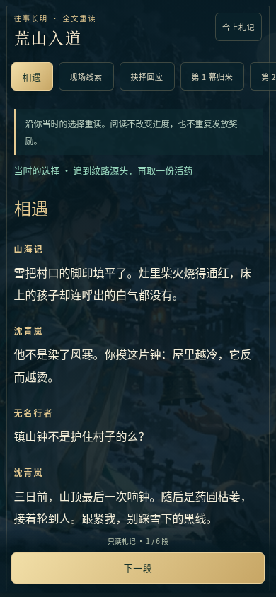
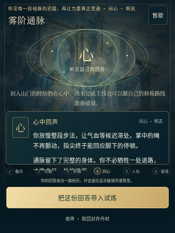
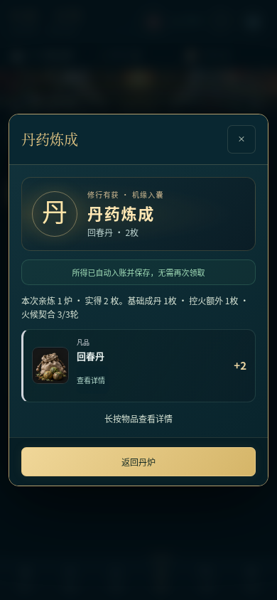
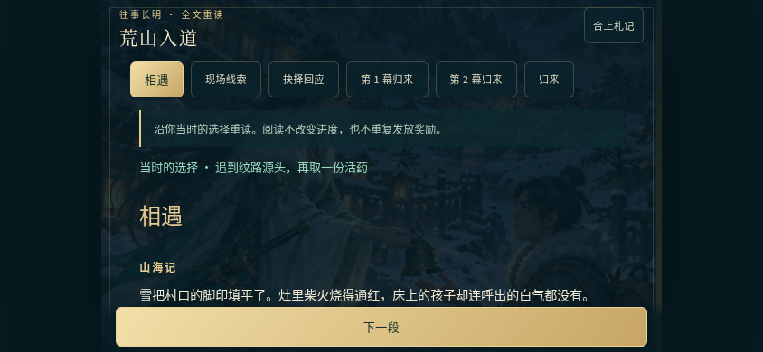

# V4.3 验证记录

2026-10-16。375 项逻辑、155 项浏览器检查（151 源页面＋4 离线文件）通过；原始音画逐字节保留。Android 4.3/code7 构建、签名与 107 个 Web 资源一致性通过。六个公开附件已匿名完整下载并核对 SHA-256；源码快照 666 个文件逐项通过，独立解压后 375 项逻辑检查也通过。尚未进行 Android 真机验证。

- [公开下载与源码逐文件证明](public-release.json)
- [源码包独立运行记录](source-archive-node.log)
- [GitHub Android 检查](https://github.com/Yi-Lings/wendao-lingqi/actions/runs/38934574621)
- [GitHub 校验与发布](https://github.com/Yi-Lings/wendao-lingqi/actions/runs/38935165422)
- [本轮方案、制作口径与旧档兼容](../../ITERATION_V4_3.md)
- [逻辑、浏览器、原始资源散列和截图清单](summary.json)
- [375 项逻辑运行记录](node.log)
- [真实操作检查与夹具边界](browser-v43.json)
- [V4.3 发布下载](https://github.com/Yi-Lings/wendao-lingqi/releases/tag/v4.3.0-preview)

| 全文重读 | 炼体问心 | 炼丹结算 |
| --- | --- | --- |
|  |  |  |

中后期和旧档使用明确标记的进度/资源夹具，随后执行真实界面操作；它们验证事务和可见交互，不证明自然经济可达性。完整路线由独立引擎模拟使用真实动作与加速等待验证。
