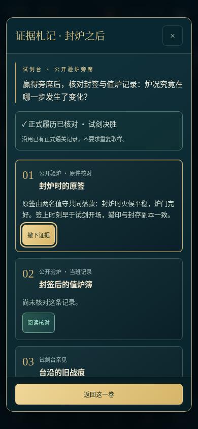
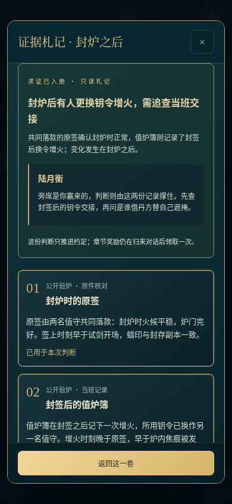
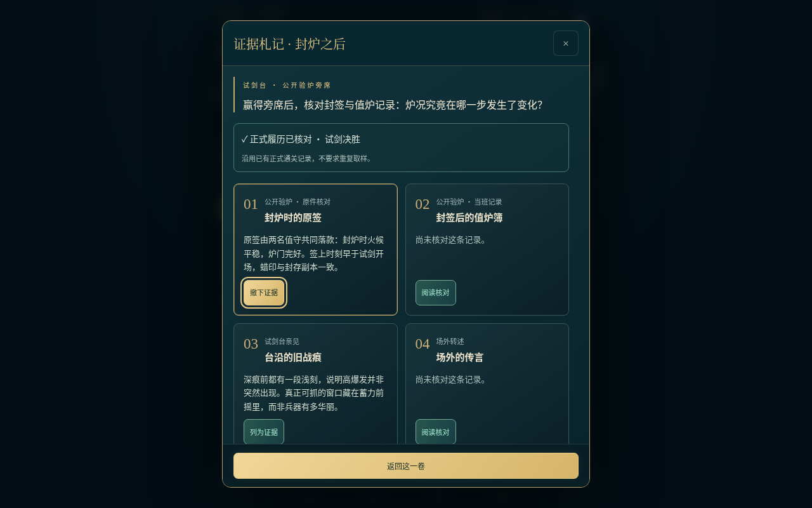

# V4.4 验证记录

2026-10-17。394 项逻辑、174 项浏览器检查（169 源页面＋5 实际 file:// 离线文件）通过。108 个 Web 资源与 APK 逐字节相同，61 项原有 PNG/MP3 保留原字节；4.4/code8 的 APK 构建、签名与对齐通过。尚未进行 Android 真机验收。

- [本轮求证方案与旧约定兼容](../../ITERATION_V4_4.md)
- [逻辑、浏览器、资源散列与截图清单](summary.json)
- [394 项逻辑检查原始日志](node.log)
- [完整浏览器检查原始日志](browser-full.log)
- [两案真实操作、保存失败与尺寸检查](browser-v44.json)
- [离线文件中求证、制作和重读](browser-offline.json)
- [两路线合法行动与加速等待的完整历程](playthrough.json)
- [APK 包名、版本与逐文件审计](apk-v44-check.txt)
- [原体验签名证明](apk-signature.txt)
- [main 分支 Android CI](https://github.com/Yi-Lings/wendao-lingqi/actions/runs/39012547822)
- [work 分支 Android CI](https://github.com/Yi-Lings/wendao-lingqi/actions/runs/39012548044)

| 证据核对 | 成功回应 | 跨卷承接 |
| --- | --- | --- |
|  |  |  |

界面使用明确标记的境界、资源、已有履历夹具；单独的正式战斗案例使用持久战斗属性与加速应用时钟，验证真实界面战斗结算后求证仍需主动提交。完整引擎路线使用合法行动与加速等待。这些检查不证明自然最短时长、长期平衡或 Android 文件选择器、系统返回和持续运行表现。预期展示故障在对应报告中单列，其余正常场景没有脚本、控制台或网络异常。
