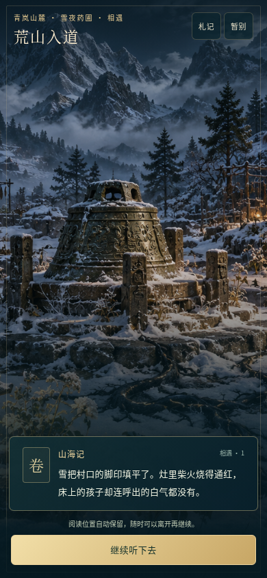
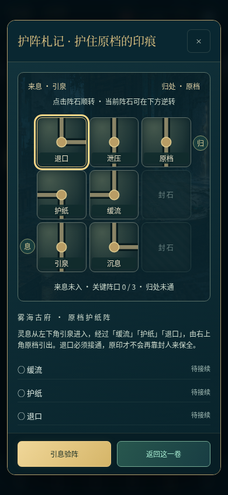
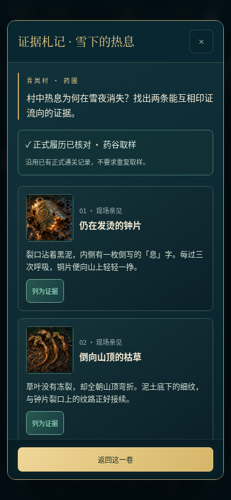
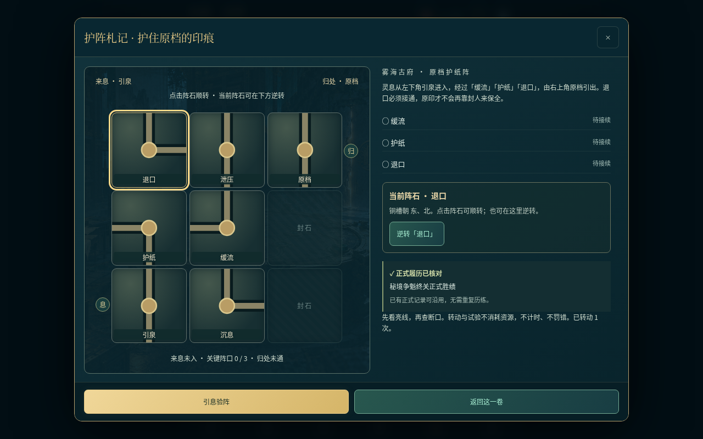
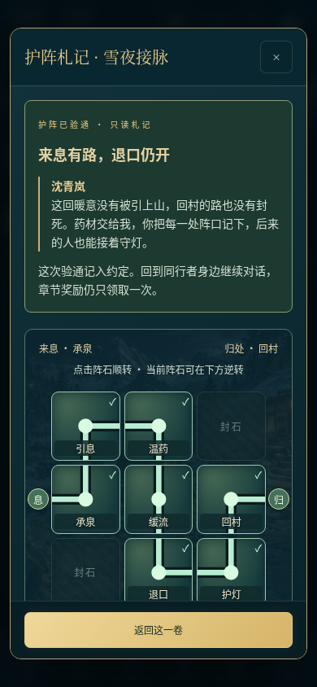

# V4.5 验证记录

2026-10-20。419 项逻辑、203 项浏览器检查（196 源页面＋7 实际 file:// 离线文件）通过，144 张截图收录于此。Android 4.5/code9 构建、原体验签名与对齐通过；115 个 APK 内资源逐字节匹配源码，125 个输入绑定冻结提交。原 61 项 PNG/MP3 保留原字节，新增 4 个生成 PNG（3 场景＋8 格证据）。尚未进行 Android 真机验收。

- [机制、旧规则兼容与边界](../../ITERATION_V4_5.md)
- [四款游戏、三部小说及交互规范的资料复核](../../RESEARCH_V4_5.md)
- [生成美术尺寸、散列与用途](../../art/V4_5_GENERATED_ASSETS.json)
- [本轮原画方向](../../art/V4_5_ART_DIRECTION.md)
- [机器汇总、源资源散列与全部截图](summary.json)
- [419 项逻辑原始日志](node.log)
- [四条合法完整引擎路线](playthrough.json)
- [完整浏览器原始日志](browser-full.log)
- [护阵、实际取药、回滚、裁切、键盘及多尺寸检查](browser-v45.json)
- [离线旋石、刷新、绘画原字节检查](browser-offline.json)
- [APK 审计](apk-v45-check.txt) 与 [原体验签名证明](apk-signature.txt)
- [main 分支 CI](https://github.com/Yi-Lings/wendao-lingqi/actions/runs/39353572480)
- [work 分支 CI](https://github.com/Yi-Lings/wendao-lingqi/actions/runs/39353572889)

| 雪夜入境 | 旋石接脉 | 证据辨认 |
| --- | --- | --- |
|  |  |  |

界面除新档入口外使用明确标记的境界、库存、已有胜绩与战斗属性夹具；正式取药案例通过真实应用战斗、加速时钟与普通按钮完成。四条引擎路线均从普通新档开始，以合法行动与加速资源等待覆盖全部人界和仙界节点。加速等待不证明最短时长或自然节奏。正常场景未出现未捕获脚本、控制台或网络异常，预期展示故障单列。

## 公开交付

[V4.5 下载页](https://github.com/Yi-Lings/wendao-lingqi/releases/tag/v4.5.0-preview) · [发布工作流](https://github.com/Yi-Lings/wendao-lingqi/actions/runs/39354472290)。发布提交 `a2ce5600b915ed66be5989b4fcb2a680894394f3`；后续提交仅补交付证据与文档。

六项资产均通过匿名 HTTPS 下载，文件大小、GitHub digest、公开 SHA256 完全一致。公开 APK 和离线 ZIP 与已测版本逐字节相同，ZIP CRC、内部 HTML 散列通过。完整源码包的 1014 项文件逐项匹配发布提交；干净工作树的同源包独立解压后 419 项逻辑测试通过。公开源码 ZIP 330461687 字节，SHA256 `b057b0eec33df2e53502c150a8f9550a11f1b1be232cf64e1ee88349f4d3fec2`。

- [匿名下载与完整性核验](public-release.json) / [原始日志](public-verification.log)
- [发布工作流证据](github-publish.json) / [公开发布 API 快照](github-release.json)
- [独立源码包测试日志](source-archive-node.log) / [本地源码打包记录](local-source-package.json)

本地与发布流水线的源码 ZIP 创建时间不同，因此容器 ZIP 的散列可以不同；每个源码文件均单独核对。公开源码包对应发布提交，后补交付记录可在 main/work 查阅。
