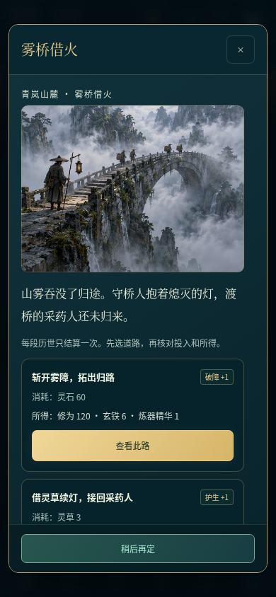
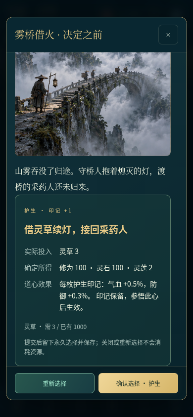
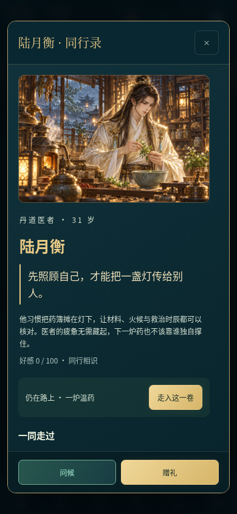
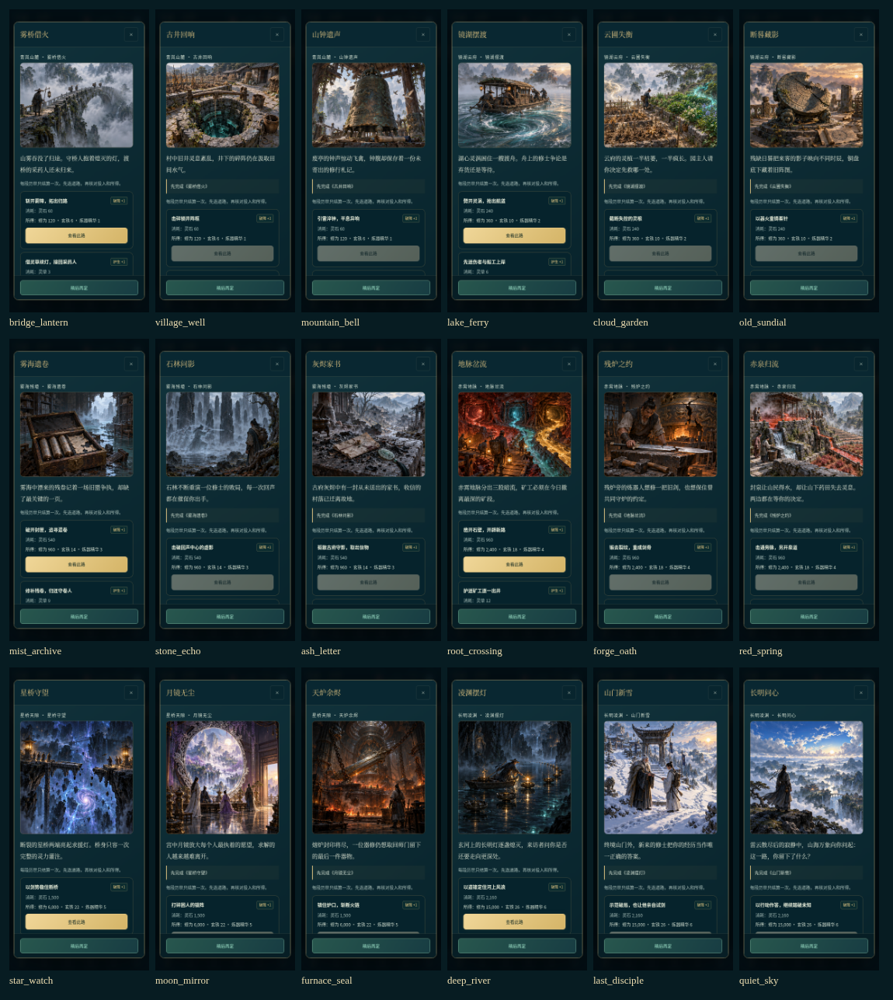
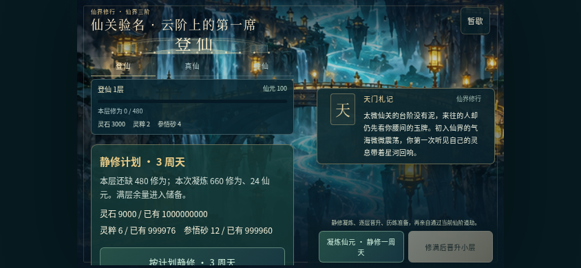
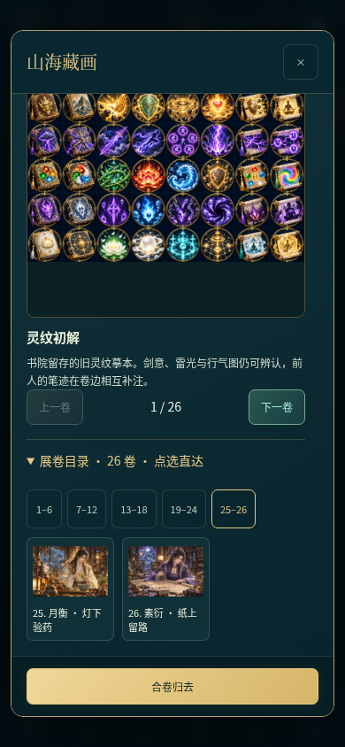

# V4.6 验证与评审证据

2026-10-20。431 项逻辑、227 项浏览器检查通过（218 源页面＋9 实际 file://）；209 张截图包含 8 张 V4.5 基线和 1 张十八事件联系表。新增 9 个原始 PNG（24 幅插画），原 65 个 PNG/MP3 保留字节。Android 4.6/code10 编译、原体验签名与对齐通过；128 个 APK 内资源匹配源码，138 项构建输入绑定提交 `773af0e0f3a428af7f0576b2638825ac48576964`。尚无 Android 真机结果。

- [项目详细自评与十二项意见](../../review/PROJECT_REVIEW_V4_6.md)
- [改进方案、机制与兼容](../../ITERATION_V4_6.md)
- [本轮美术方向与接线](../../art/V4_6_ART_DIRECTION.md)
- [尺寸、字节、散列](../../art/V4_6_GENERATED_ASSETS.json) / [完整生图提示](../../art/V4_6_GENERATION_RECORDS.json)
- [机器汇总与 209 张截图散列](summary.json)
- [431 项逻辑日志](node.log) / [四条合法公共行动路线](playthrough.json)
- [本轮 22 项界面专项](browser-v46.json) / [实际离线文件](browser-offline.json)
- [APK 审计](apk-v46-check.txt) / [签名](apk-signature.txt) / [冻结输入](source-input-check.log)
- [手工脚本语法与实际版本解析](manual-version-check.json)

## 回归运行说明

所有十三份最终浏览器报告均通过。本轮使用一次全量初跑，随后定点复测飞升与完整性套件：新增批量按钮后，两条旧用例原来的无条件选择器点到了批量静修，现明确选择 count:1，保留单轮费用断言，另由新专项验证批量费用。为避免重复执行已经通过的其余套件，完成定点复测后汇总全部最终报告。

- [全量初跑原始日志（含当时断言失败）](browser-full-initial.log)
- [飞升流程修正后复测](browser-ascension-recheck.log)
- [完整性套件最终复测](browser-integrity-final.log)
- [最终飞升报告](browser-ascension.json) / [最终完整性报告](browser-integrity.json)

正常场景无未捕获脚本、控制台或资源请求失败。完整性套件主动注入的一次提交后展示故障单列为预期，不混入正常场景。新界面除只读新档入口外使用明确的境界、资源和故事进度夹具；独立四条合法引擎路线从普通新档行动，以加速资源等待覆盖全部人界与仙界节点。加速等待不代表自然耗时或长期平衡。

## 实际画面

| 雾桥借火 | 所选道路复核 | 同行录 |
| --- | --- | --- |
|  |  |  |

main/work Android CI 均成功：[main](https://github.com/Yi-Lings/wendao-lingqi/actions/runs/39383140162) / [work](https://github.com/Yi-Lings/wendao-lingqi/actions/runs/39383140218)。

## 公开交付已核验

[V4.6 下载页](https://github.com/Yi-Lings/wendao-lingqi/releases/tag/v4.6.0-preview) · [发布工作流](https://github.com/Yi-Lings/wendao-lingqi/actions/runs/39383470262)。发布提交 `cde26069796cf732ea930f734202221346b58507`，APK 输入源冻结于 `773af0e0f3a428af7f0576b2638825ac48576964`；后补交付证据的提交不改变游戏和构建输入。

六项资产通过匿名 HTTPS 下载、大小、GitHub digest 和公开 SHA256 校验。公开 APK 与离线 ZIP 与已测字节一致；ZIP CRC 与内部 HTML SHA 相同。完整源码包 1284 个文件逐项匹配发布提交，干净工作树的同源包独立解压后 431 项逻辑测试通过。公开源码 ZIP 415238795 字节，SHA256 `65b056bf4a2d4b95d4e6f593cbe151a0de5af8e35106666c7182ebbcc448a5b6`。

- [全部匿名下载与源码文件核验](public-release.json) / [原始日志](public-verification.log)
- [发布流程证据](github-publish.json) / [公开发布 API](github-release.json)
- [独立源码包测试](source-archive-node.log) / [本地打包记录](local-source-package.json)

本地与发布流程的源码 ZIP 创建时间不同，ZIP 容器散列可以不同；内部每个文件都已独立核对。源码包对应发布提交，后补交付记录在 main/work 中保留。
